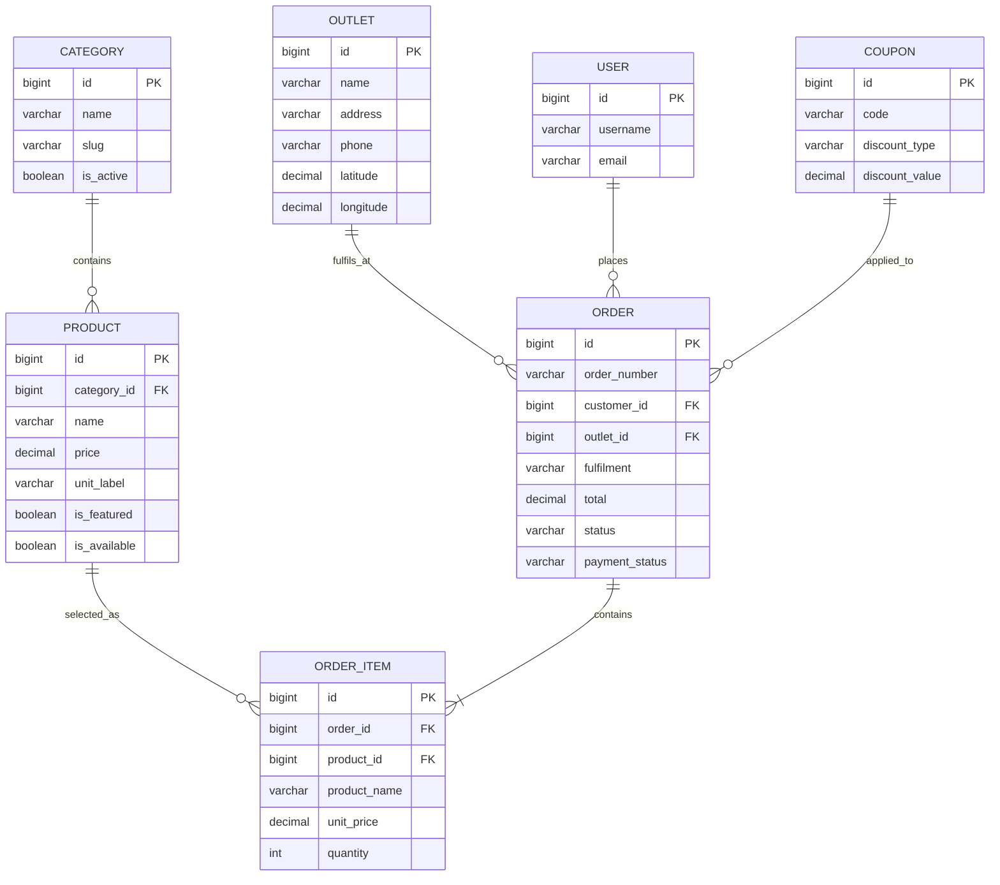

# Database design — TAZA FOOD CORNER

## Main entities

- **Category** 1-to-many **Product**: a category groups menu items.
- **Outlet** 1-to-many **Order**: an order can reference the selected outlet.
- **User** 1-to-many **Order**: an authenticated customer can view their own orders; guest checkout is also supported.
- **Order** 1-to-many **OrderItem**: the order stores an immutable item name/price snapshot and quantity.
- **Product** 1-to-many **OrderItem**: a nullable product reference preserves the order line if a menu item is deleted.
- **Coupon** 1-to-many **Order**: an order stores the coupon relationship and the applied coupon code.
- **Feedback** stores visitor feedback independently.

The cart is held in the Django session so guests can add items before signing in. Order lines are persisted in the database when checkout is submitted.

## ER diagram

## Tables created by the included migration

`store_category`, `store_product`, `store_outlet`, `store_coupon`, `store_order`, `store_orderitem`, `store_feedback`, plus Django's built-in authentication/session/admin tables.
