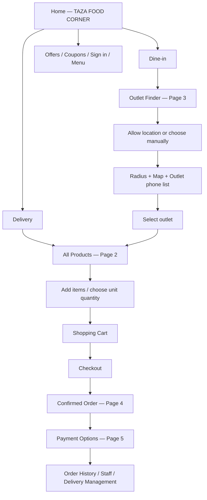

# Website flow — TAZA FOOD CORNER

## Main systems

- Frontend: Django templates, HTML, CSS and JavaScript.
- Backend: Django views, forms, authentication and order/cart logic.
- REST API: Django REST Framework endpoints for nearby outlets, menu products and the signed-in customer's orders.
- Database: SQLite by default; MySQL supported for XAMPP.
- Map: Leaflet with OpenStreetMap tiles and browser geolocation.
- Admin: Django Admin for products, categories, outlets, coupons, orders and feedback.
